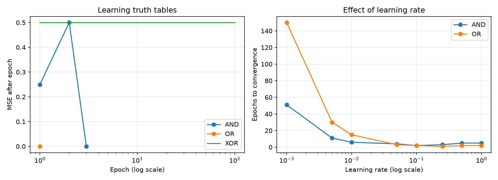

# Workshop 2: perceptron experiments

For a concise recap of the concepts, see the [week 2 quick reference](REFERENCE.md).

Run `python wk2/perceptron_DL.py` from the workshops folder. It prints the
experiments, displays the plots and saves `perceptron_experiments.png` here.

## How the code learns

For an input vector `x`, the perceptron predicts 1 when `dot(w, x) >= theta`,
otherwise 0. Its boundary is a straight line for these two-input examples.
The threshold is equivalent to a bias of `-theta`.

For each example, `error = target - prediction`. Update the weights with
`w = w + alpha * error * x`, and the threshold with
`theta = theta - alpha * error`. A correct prediction makes no change.

An epoch is one pass through all four examples. The recorded MSE is calculated
using the weights **after** that complete pass. With binary targets and outputs,
each wrong answer contributes 1 to squared error, so MSE is also the fraction
of incorrect truth-table predictions. The original lecture-style loop accumulated
errors during updates instead, which can give a different stopping epoch.

## Truth-table results

Inputs are ordered `(0,0), (0,1), (1,0), (1,1)`. Starting weights are `[0, 0.4]`,
threshold is `0.3`, learning rate is `0.25`, and the target MSE is zero.

| Gate | Targets | Final predictions | Epochs | Final MSE | Converged |
|---|---|---|---|---|---|
| AND | 0, 0, 0, 1 | 0, 0, 0, 1 | 3 | 0.00 | Yes |
| OR | 0, 1, 1, 1 | 0, 1, 1, 1 | 1 | 0.00 | Yes |
| XOR | 0, 1, 1, 0 | 1, 1, 0, 0 | 100 | 0.50 | No: epoch limit |

AND and OR are linearly separable: a straight line can separate their two labels.
XOR places the positive examples on opposite corners and cannot be separated
from the negative examples by one straight line. Changing the learning rate
cannot fix this representational limit. A network with a nonlinear hidden layer
could represent XOR, but that is a different model.

The maximum epoch count prevents the XOR experiment from running forever.
Reaching that limit does **not** mean training succeeded; check `converged_`.

## Learning-rate results

Each run starts from the same weights and threshold and uses the same example
order. All the following runs reached zero MSE within the 5,000-epoch limit.

| Learning rate | AND epochs | OR epochs |
|---|---|---|
| 0.001 | 51 | 150 |
| 0.005 | 11 | 30 |
| 0.01 | 6 | 15 |
| 0.05 | 4 | 3 |
| 0.1 | 2 | 2 |
| 0.25 | 3 | 1 |
| 0.5 | 5 | 2 |
| 1.0 | 5 | 2 |

Small updates take many passes to move away from these initial parameters.
Increasing the rate initially reduces the required epochs, but the relationship
is not monotonic: AND takes two epochs at 0.1 and five at 0.5. Larger updates can
jump across a useful boundary and require additional corrections. These results
depend on the initial parameters and example order; they do not establish one
best learning rate for every dataset or model.

